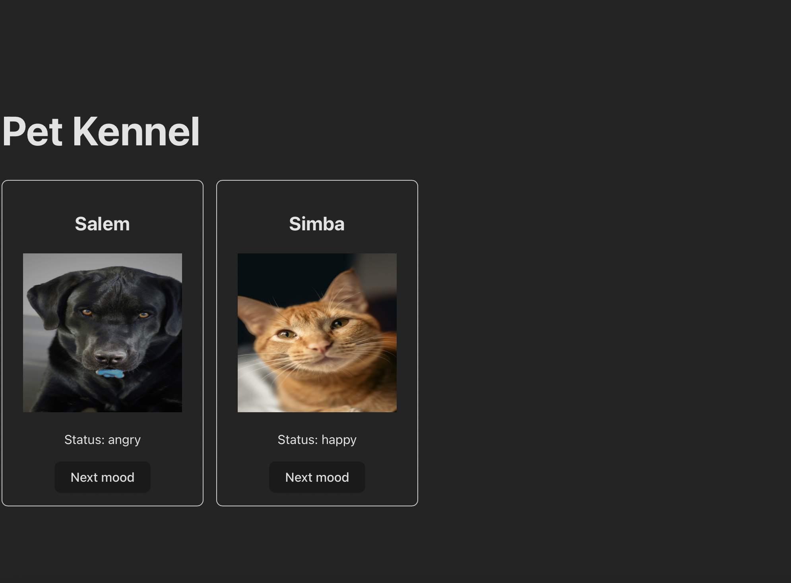

# Pet Kennel

A small React app that shows a list of pets. Each pet card shows the pet's name and photo. Clicking the button cycles through the pet's images (happy, angry, sleeping). I built it to practice class-based components, lifting state up, passing props and callbacks, and mapping over an array.

## Demo

## Installation

Requires Node.js v18+ and npm.

    git clone  https://github.com/andregiovannimiles-ctrl/petKennel.git
    cd petKennel
    npm install
    npm run dev

Vite usually serves the app at http://localhost:5173. Check your terminal for the exact URL.

## Usage

1. Open the app in your browser.
2. Each pet card shows the pet's current image.
3. Click "Next mood" on a card to cycle to the next image.
4. State lives in the parent component (App.jsx) and is passed to children through props.

## Technologies Used

- React 19
- Vite 7
- Node.js

## License

MIT